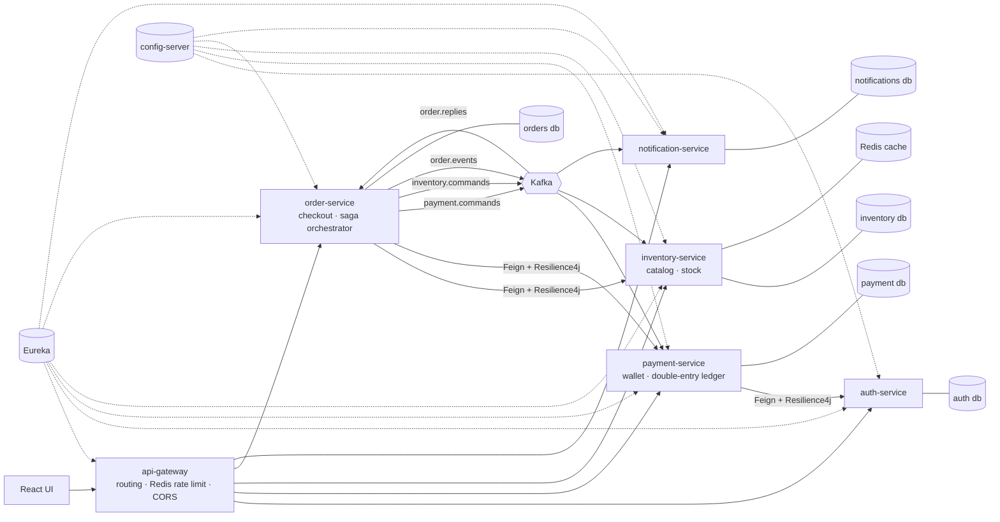
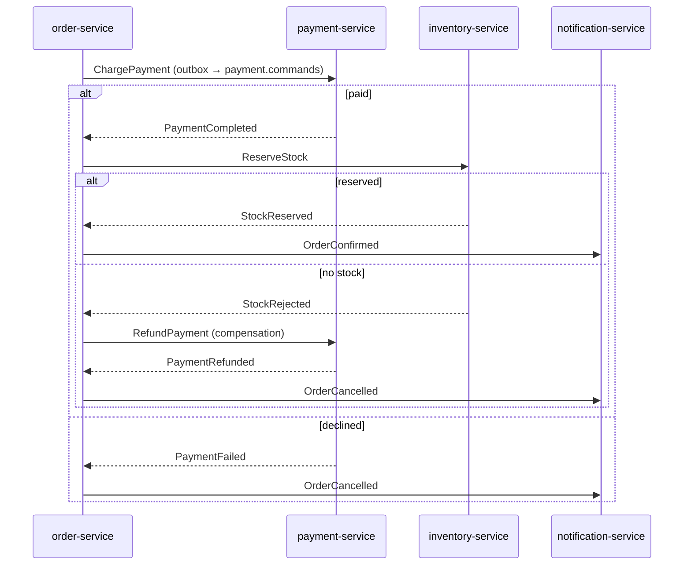

# PayFlow

An event-driven order and payments platform built with **Java 21, Spring Boot 3 and Spring Cloud** as microservices. A user signs up, tops up a wallet and places an order. The order is paid from the wallet, stock is reserved and a notification is sent. If payment or stock fails, a saga with compensating actions rolls the order back.

## Architecture



### Order saga (orchestration)



Each step is one local transaction that writes the business change, the inbox row (dedupe) and the outbox row (next message) together. The outbox relay publishes with `FOR UPDATE SKIP LOCKED`, so it is safe with many instances. Every consumer is idempotent, and a message that keeps failing goes to `<topic>.DLT`.

## Modules

| Module | Port | What it does |
|---|---|---|
| `platform/payflow-common` | – | API envelope, error handling, JWT security, data structures, event contracts, logging, metrics/tracing deps |
| `platform/payflow-messaging` | – | Transactional outbox, inbox (idempotent consumer), Kafka error handler + dead-letter topics |
| `infra/discovery-server` | 8761 | Eureka |
| `infra/config-server` | 8888 | Spring Cloud Config (native backend, `config-repo/`) |
| `infra/api-gateway` | 8080 | Spring Cloud Gateway: routes, Redis rate limiting, CORS, correlation id |
| `services/auth-service` | 8081 | Users, BCrypt, JWT, login rate limiting |
| `services/payment-service` | 8082 | Wallets, double-entry ledger, idempotent top-ups/transfers/payments, fraud graph, saga participant, retry scheduler |
| `services/inventory-service` | 8083 | Catalog, Trie autocomplete, Redis `@Cacheable`, stock reservations (saga participant) |
| `services/order-service` | 8084 | Checkout (parallel Feign calls), order state machine, saga orchestrator, timeout job, Thymeleaf admin UI |
| `services/notification-service` | 8085 | Consumes order events, stores and sends notifications |
| `ui/` | 5173 | Minimal React UI |
| `k8s/` | – | Deployments, Services, HPA, Ingress |

## Run it

You need JDK 21, Maven 3.9 and Docker (with about 6 GB of RAM for Docker). For the UI and the load test you also need Node 20 and k6.

```bash
echo "api.version=1.44" > ~/.docker-java.properties   # once: Testcontainers + Docker Engine 29+
mvn -B verify                 # build + all tests (Testcontainers needs Docker running)
docker compose up -d --build  # whole stack; first build takes a few minutes
```

| What | URL |
|---|---|
| API through the gateway | http://localhost:8080 |
| Eureka dashboard | http://localhost:8761 |
| Zipkin traces | http://localhost:9411 |
| Prometheus | http://localhost:9090 |
| Grafana ("PayFlow overview" dashboard) | http://localhost:3000 |
| Admin UI (HTTP Basic `admin` / `Admin12345!`) | http://localhost:8080/admin-ui/orders |
| Swagger per service | http://localhost:808x/swagger-ui.html (ports 8081–8085, from the host only if you publish them) |

Dev admin user (created by auth-service in the default/dev/docker profiles): `admin@payflow.dev` / `Admin12345!`.

UI:

```bash
cd ui && npm install && npm run dev   # http://localhost:5173
```

Smoke test:

```bash
TOKEN=$(curl -s localhost:8080/api/v1/auth/register -H 'Content-Type: application/json' \
  -d '{"email":"me@payflow.dev","password":"Password123"}' | jq -r .data.accessToken)
curl -s localhost:8080/api/v1/wallets/me/top-ups -H "Authorization: Bearer $TOKEN" \
  -H 'Idempotency-Key: first-topup-0001' -H 'Content-Type: application/json' -d '{"amountMinor":5000000}'
PID=$(curl -s 'localhost:8080/api/v1/products?size=1' | jq -r '.data.items[0].id')
curl -s localhost:8080/api/v1/orders -H "Authorization: Bearer $TOKEN" -H 'Idempotency-Key: first-order-0001' \
  -H 'Content-Type: application/json' -d "{\"items\":[{\"productId\":\"$PID\",\"quantity\":1}]}"
curl -s localhost:8080/api/v1/orders -H "Authorization: Bearer $TOKEN"   # status goes PENDING → PAID → CONFIRMED
```

## API (v1, through the gateway)

| Method | Path | Service | Notes |
|---|---|---|---|
| POST | `/api/v1/auth/register`, `/login` | auth | rate limited per IP |
| GET | `/api/v1/auth/me` | auth | |
| GET | `/api/v1/users/lookup?email=` | auth | used by payment-service via Feign |
| GET | `/api/v1/wallets/me`, `/me/summary`, `/me/transactions`, `/me/statement`, `/me/balance-at`, `/me/report` | payment | wallet opened lazily on first use |
| POST | `/api/v1/wallets/me/top-ups` | payment | `Idempotency-Key` |
| POST | `/api/v1/transfers` | payment | `Idempotency-Key`; recipient by email |
| POST | `/api/v1/payments` | payment | WALLET or CARD (stub); `Idempotency-Key` |
| GET/POST | `/api/v1/admin/wallets/{id}`, `/freeze`, `/unfreeze` | payment | ETag / If-Match |
| GET/POST | `/api/v1/admin/fraud-alerts`, `/admin/fraud/scan`, `/admin/stats` | payment | admin |
| GET | `/api/v1/products`, `/products/{id}`, `/products/batch?ids=`, `/products/autocomplete?q=` | inventory | public |
| POST/PUT | `/api/v1/admin/products`, `/admin/products/{id}/stock` | inventory | admin |
| POST | `/api/v1/orders` | order | `Idempotency-Key`; returns **202**, the saga finishes asynchronously |
| GET | `/api/v1/orders`, `/api/v1/orders/{id}` | order | |
| GET | `/api/v1/admin/orders?status=` | order | admin |
| GET | `/admin-ui/orders` | order | Thymeleaf page, HTTP Basic |
| GET | `/api/v1/notifications/me` | notification | |

## Concept → where it is used (interview cheat sheet)

Every use in the code is marked with a `// Concept:` comment.

| Concept | Where |
|---|---|
| Encapsulation + invariants | `payment-service/.../wallet/Wallet.java`, `inventory-service/.../catalog/Product.java` (`reserve`), `order-service/.../order/Order.java` |
| Inheritance + abstract class | `payment/method/PaymentMethod.java` → `WalletPayment`, `CardPaymentStub` |
| Polymorphism / Strategy | `PaymentMethodFactory.forType`, `NotificationChannel` implementations |
| Factory | `payment/method/PaymentMethodFactory.java` |
| Template Method | `PaymentMethod.pay()` |
| Builder | `wallet/LedgerEntry.Builder` |
| Observer (domain events) | `TransferCompletedEvent` → `fraud/FraudMonitor` |
| Singleton via Spring | every default-scoped bean, e.g. `auth/AuthConfig.loginRateLimiter` (README → JVM section explains why not hand-rolled) |
| Composition over inheritance | `PaymentMethod` holds a `FeePolicy` |
| Interfaces with default methods, functional interfaces, lambdas | `payment/method/FeePolicy.java` |
| SOLID | Open/Closed: a new payment method or notification channel is one new class. Single responsibility: `WalletService` vs `WalletQueryService`, `CheckoutService` vs `OrderWriter`. Dependency inversion: constructor injection everywhere |
| Records (DTOs) | all `dto/` packages, events, `Money`, `ApiResponse`, `PageResponse` |
| Enum with behaviour / state machine | `order/OrderStatus.java`, `wallet/Direction.java`, `wallet/report/ReportBucket.java` |
| Sealed interfaces + pattern-matching switch | `common/events/*` (+ Jackson polymorphism), `PaymentResult`, `DebitOutcome`, `OrderSagaOrchestrator.handle`, `GlobalExceptionHandler` |
| Generics | `ApiResponse<T>`, `PageResponse<T>`, `LruCache<K,V>`, `RetryQueue<T>`, `IdempotencyService.run<T>` |
| Optional | repositories, `BalanceHistory` (`OptionalLong`), `CheckoutGateway.balance` |
| Streams (grouping, partitioning, toMap merge) | `TransactionReport`, `LedgerTransaction.assertBalanced`, `CheckoutService`, `StockService`, `AdminUiController` |
| Immutability | `Money`, records, trie swapped through a `volatile` field |
| equals/hashCode | `Money` (value), entities (id-based), embedded ids |
| Comparable / Comparator | `Money`; `TransferGraph.findCycles`; `RetryQueue` heap comparator |
| Checked vs unchecked exceptions | `InvalidTokenException` (checked); `common/error/*` (unchecked) |
| try-with-resources | `ProductCatalogLoader.read`, `StatementCsvWriter.write`, tests' `ExecutorService` |
| @ControllerAdvice | `common/error/GlobalExceptionHandler.java` |
| ConcurrentHashMap | idempotency in-flight registry, rate limiter |
| LRU (LinkedHashMap) | `common/ds/LruCache.java` (autocomplete results in inventory) |
| PriorityQueue retry scheduler | `common/ds/RetryQueue.java` + `payment-service/.../saga/PaymentRetryScheduler.java` |
| ArrayDeque sliding window | `common/ds/SlidingWindowRateLimiter.java` |
| TreeMap | `TransactionReport`, `ProductNameTrie` children |
| Trie | `inventory-service/.../catalog/ProductNameTrie.java` |
| Graph + BFS/DFS | `payment-service/.../fraud/TransferGraph.java` |
| Binary search | `wallet/BalanceHistory.java` |
| Virtual threads, ExecutorService | `common/config/AsyncConfig.java` |
| CompletableFuture | `order/CheckoutService.java` (parallel Feign calls), `wallet/WalletSummaryService.java` |
| synchronized vs ReentrantLock, AtomicLong | `TransferGraph`/`SlidingWindowRateLimiter` vs `LruCache`/`RetryQueue` |
| CountDownLatch | `payment-service/.../wallet/WalletConcurrencyTest.java` |
| Spring MVC REST + Thymeleaf view | `*Controller.java`; `order/admin/AdminUiController` + `templates/orders.html` |
| Content negotiation | `WalletController.statement` (JSON / CSV) |
| Bean scopes | `common/web/RequestContext` (request scope) |
| Profiles | `AdminBootstrap`, `logback-spring.xml` (JSON logs in docker/k8s) |
| @ConfigurationProperties | `JwtProperties`, `WalletProperties`, `RateLimitProperties`, `CacheProperties`, `AdminUiProperties` |
| @Transactional propagation/isolation | MANDATORY (`IdempotencyService`, `OutboxWriter`, `Inbox`), REQUIRES_NEW (`FraudAlertStore`, `WalletOpener`), READ_COMMITTED (`WalletService.transfer`) |
| JPA relationships, N+1 fix | `LedgerTransaction`/`LedgerEntry`, `Order`/`OrderItem`, `@EntityGraph`, `LedgerRepositoryTest` |
| Optimistic / pessimistic locking | `@Version` + ETag (`AdminWalletController`); `FOR UPDATE` with lock ordering (`WalletService`, `ProductRepository.findAllForUpdate`) |
| Flyway | `*/src/main/resources/db/migration`, messaging tables shipped inside `payflow-messaging` |
| Spring Security, JWT, BCrypt, @PreAuthorize | `common/security/*`, a second filter chain with HTTP Basic (`AdminUiSecurityConfig`) |
| Microservices: Gateway, Eureka, Config, Feign, Resilience4j | `infra/*`, `AuthUserClient`/`RecipientResolver`, `CatalogClient`/`WalletClient`/`CheckoutGateway` |
| Kafka, saga, outbox, idempotent consumer, DLT | `platform/payflow-messaging`, `OrderSagaOrchestrator`, `OrderPaymentService`, `StockService`, `NotificationService` |
| Redis caching + rate limiting | `@Cacheable`/`@CacheEvict` in `ProductService`; gateway `RequestRateLimiter` |
| @Async, @Scheduled | `FraudMonitor.onTransfer`; `OutboxRelay`, `PaymentRetryScheduler`, `SagaTimeoutJob` |
| Observability | Actuator + Prometheus + Grafana (`deploy/`), Zipkin tracing (incl. through Kafka), JSON logs with traceId/correlationId, `OrderMetrics` |
| Testing | JUnit 5, Mockito, AssertJ, `@WebMvcTest`, `@DataJpaTest`, Testcontainers, JaCoCo |
| CI | `.github/workflows/ci.yml`, `.gitlab-ci.yml` |

## Design decisions worth explaining

- **Money is a `long` in minor units, never `double`.** Every top-up debits a `CASH_IN` system wallet, so the sum of all balances is always 0. `/admin/stats` exposes this as a live check.
- **Lock ordering.** Wallets and products are locked in id order to rule out deadlocks.
- **No remote calls inside a database transaction.** The transfer recipient and the checkout prices are resolved before any transaction starts.
- **Outbox instead of a direct Kafka send.** It avoids "DB committed but message lost" and "message sent but DB rolled back".
- **The saga has a timeout.** A late payment for an order that was already cancelled is refunded automatically.
- **Known trade-offs.**
  - Top-ups serialize on the single `CASH_IN` row.
  - The payment retry queue lives in memory, so the saga timeout covers a restart.
  - All service databases share one Postgres server in Compose (still one database per service).

## JVM basics

- **Heap vs stack.** Each thread has its own stack (locals and frames). Objects live on the shared heap, so shared objects need synchronization.
- **Garbage collection.** Unreachable objects are reclaimed. Java 21 defaults to G1, which collects young regions often and cheaply.
- **String pool.** Literals are interned, so always compare strings with `equals`.
- **Immutability.** Immutable objects (records, `Money`) can be shared between threads without locks, and final fields are safely published.
- **Why not a hand-written Singleton.** A static singleton is hard to test and fixed for the whole JVM. A Spring singleton bean is still one instance, but it is injected and can be replaced in tests.

## Measured results

k6 load test (`load-tests/checkout.js`) through the gateway, run on 14 October 2026 on a MacBook Air (Apple Silicon) with the whole stack (14 containers: 8 Spring services, Postgres, Kafka, Redis, Zipkin, Prometheus, Grafana) in Docker Desktop. Ramp 0 → 50 virtual users over 2 minutes, each looping: list products → place order → read order, with ~1.5 s think time. Rate limits relaxed for the test (`AUTH_PROFILES=docker,loadtest`, `GATEWAY_RATE_PER_SEC=5000`), because every virtual user shares one IP.

| Metric | Result |
|---|---|
| Requests | 6,420 (53 req/s average; bounded by the script's think time, not by the server) |
| Failed requests | **0.00 %** (all checks passed: 6,219 / 6,219) |
| Place order (`POST /orders`, 202 Accepted) | p50 **7.8 ms**, p95 **19.5 ms**, max 171 ms |
| List products (`GET /products`) | p50 **3.6 ms**, p95 **10.9 ms**, max 100 ms |
| All requests | p95 **15.6 ms** |

`POST /orders` returns once the order and the first saga command are committed (the payment and stock steps then run asynchronously over Kafka), so its latency includes the parallel Feign calls to inventory and payment but not the whole saga.

Also measured by the test suite: `LedgerRepositoryTest` asserts 11 queries (N+1) vs 1 query with `@EntityGraph`.

Not measured yet: maximum throughput (needs a test without think time, ideally on separate machines for k6 and the stack).
